# Flood extent and flooded cropland from Sentinel-1, Brahmaputra valley, August 2016

Mapping flood water with radar is not hard. Saying how much of the answer comes
from the imagery and how much comes from choices nobody declares is harder, and
that is what this project is about.

<!-- headline -->
**Between 120,790 and 171,683 ha of flood water** on 12 August 2016 across 6.26
million hectares of the central Brahmaputra valley, of which **between 47,028
and 87,274 ha was cropland**.
<!-- /headline -->

That range is not measurement noise. It is the gap between two operating points
that both have an argument behind them: one chosen to maximise agreement with
hand labels pixel by pixel, the other chosen so the mapped area on the labelled
chips matches those labels before the map's clean-up step, which then takes
about a tenth off it. They differ by one decibel. Every figure in this README is
reported with the decision that moves it and the amount it moves by.

A labelled sample of the map, described
[below](#independent-check-of-the-12-august-map), puts open-water flood inside
the floodplain at **135,505 ± 13,221 ha**, against 102,758 ha mapped there at
−18.75 dB and 146,400 ha at −17.75 dB, so the true figure lies between the two.
Read by a second person, the relabelled points give 123,996 ha, and read by
Claude 118,349 ha, so which threshold comes closer depends on who reads the
hard cells.

Interactive map: [three acquisitions and the recession between them](https://sruthi-swathandran.github.io/geospatial-portfolio/01-sentinel1-flood-extent/docs/)

This repository has been through a methodological review written with an AI
assistant, Claude. It is not independent peer review. `REVIEW.md` lists every
finding with its severity and evidence, including those that remain open.
`CHANGELOG.md` records every number that changed as a result, with the
superseded value and why it was wrong.

| | |
|---|---|
| Sensor | Sentinel-1 IW GRD, RTC gamma0, VH |
| Dates | 7, 12 and 31 August 2016 |
| Resolution | 20 m |
| Method | Speckle-filtered single-date threshold, −18.75 or −17.75 dB |
| Validation | Sen1Floods11 hand labels, 65 chips, official splits; the same threshold on 309 chips of nine other floods; a stratified sample of the 12 August map labelled on Sentinel-2, and of the 7 and 31 August maps on Landsat |
| Data | Open only: Microsoft Planetary Computer, JRC, ESA, geoBoundaries |

---

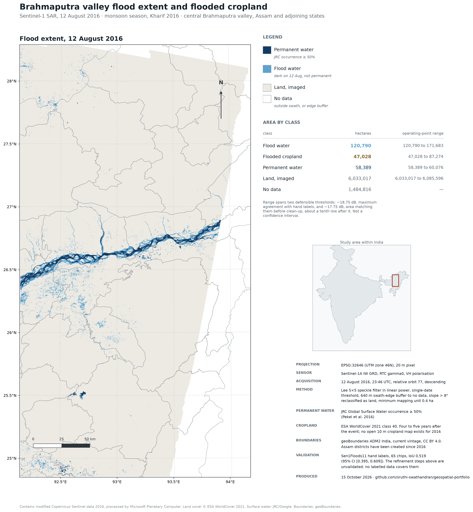

*Flood extent on 12 August 2016 at 20 m, after the swath edge buffer, the slope cut and the minimum mapping unit. Full resolution version in `results/figures/flood_extent_map.pdf`.*

## Flooded cropland by district, 12 August 2016

| District | Flooded cropland | Flood water | Cropland imaged | District imaged |
|---|---:|---:|---:|---:|
| Nagaon | 13,435 ha | 17,280 ha | 128,978 ha | 100% |
| Morigaon | 11,340 ha | 15,850 ha | 75,691 ha | 84% |
| Sonitpur | 4,534 ha | 28,624 ha | 137,015 ha | 100% |
| Biswanath | 3,218 ha | 14,397 ha | 76,739 ha | 100% |
| Hojai | 3,178 ha | 3,374 ha | 72,312 ha | 100% |
| Golaghat | 1,757 ha | 7,837 ha | 40,793 ha | 36% |
| Cachar | 1,461 ha | 2,015 ha | 31,994 ha | 49% |
| Darrang | 1,293 ha | 8,405 ha | 20,794 ha | 30% |
| Udalguri | 1,290 ha | 1,918 ha | 35,789 ha | 32% |

Full table in `results/district_flood_stats.csv`. The last column is the share
of the district the satellite swath actually saw. Rows below 50% are marked
PARTIAL and below 15% SLIVER in the console output of `district_stats.py`,
because a percentage computed over a sliver is arithmetic rather than evidence.

These rows sum to 110,938 ha of flood and 43,564 ha of flooded cropland, which
is 92% of the scene-wide totals quoted above. The remainder falls outside every
Indian district polygon. Scene-wide figures are in `results/cropland_scene.csv`.

**Flood area and flooded cropland are not the same story.** Sonitpur has the
largest flood of any district at 28,624 ha, and only 16% of it is on cropland,
against 78% in Nagaon. Sonitpur sits where the braid belt is widest, so most of
its water is in sand and channel. Relief allocated by flood area would go to
Sonitpur; relief allocated by flooded cropland would go to Nagaon.

---

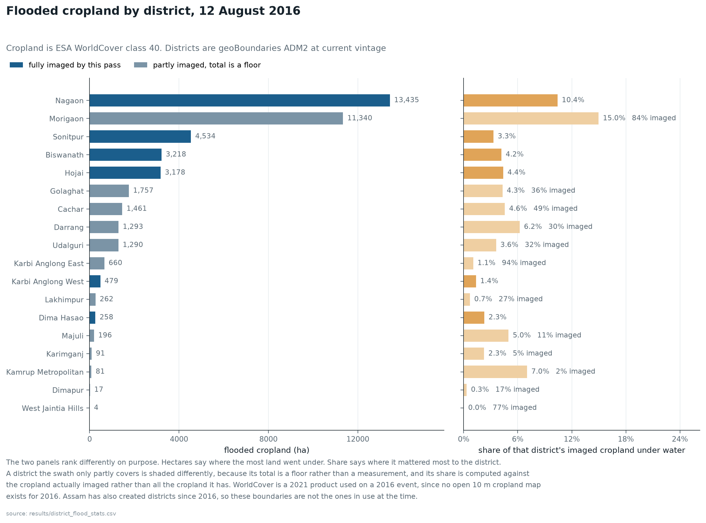

*Flooded cropland by district on 12 August 2016. Cropland is ESA WorldCover class 40.*

## Two operating points, one bracket

The threshold was chosen twice against two criteria. Both choices are defensible.

| | Map-optimal | Area-matched |
|---|---:|---:|
| Threshold | −18.75 dB | −17.75 dB |
| Chosen to | maximise IoU on the valid split | make mapped area match the labels, before clean-up |
| Chip-scale IoU, all 65 | 0.519 | 0.522 |
| Chip-scale mapped water | 14,405 ha (−22.1% vs labels) | 18,422 ha (−0.3%) |
| Full scene, raw threshold | 217,490 ha | 319,398 ha |
| Full scene, refined | 120,790 ha | 171,683 ha |
| Flooded cropland | 47,028 ha | 87,274 ha |

The two are statistically indistinguishable on the chips: 0.519 and 0.522, well
inside a confidence interval of ±0.11. They differ by 42% on flood area and 86%
on flooded cropland.

A map user wants the first. Anyone buying a hectare figure wants the second,
because the first recovers only 78% of hand-labelled water, and both fall
further short once the clean-up step is counted (below). Publishing one
without saying which is how a flood map ends up quoted for a purpose it was
never tuned for, and earlier versions of this README did exactly that: they gave
a hectare figure computed at the map-optimal point.

**The chips and the scene differ by one clean-up step.** `full_scene.py`
removes water patches and holes under 25 pixels before anything is counted, and
the chip figures above were scored without it. At the scene's 20 m, 25 pixels
is 1 ha. Measured on the 65 chips with the same 1 ha limit
(`results/register_check_clean.csv`), the step lowers mapped water by 7.9% at
−18.75 dB and 9.9% at −17.75 dB. IoU falls from 0.519 to 0.514 at the first and
rises from 0.522 to 0.529 at the second. So on the chips the pipeline behind
the scene's area-matched figure maps 10.2% less water than the labels, against
the 0.3% in the table, and the upper end of the bracket is itself likely to be
low. An earlier version of this paragraph measured the step at the chips' own
10 m, where 25 pixels is a quarter of a hectare, and gave 2.9%, 3.4% and 3.7%
(N-03 in `CHANGELOG.md`). The Lee filter's noise term
also differs, taken per chip in validation and per tile in the scene. Fixing it
to one pooled value moved chip IoU by 0.001 and mapped area by under 0.4% at
either point (`results/register_check_lee.csv`). The chips cannot show how
large that effect is on scene tiles that contain hills.

**The ranking is robust even though the magnitude is not.** Nagaon, Morigaon and
Sonitpur are first, second and third at both thresholds. Below that the order
shuffles; Karbi Anglong East moves from tenth to sixth. Who was worst affected
survives the choice. How much does not.

Full area-matched outputs are in `results/district_flood_stats_areamatched.csv`.
The raster itself, `results/fullscene/India_water_20m_areamatched_refined.tif`,
is not in the repository, since no raster is; `full_scene.py` and
`refine_scene.py --apply` produce it at the area-matched threshold.

---

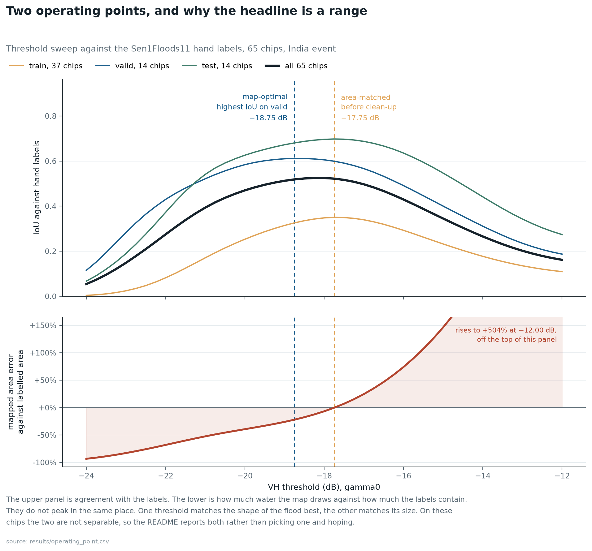

*IoU against the Sen1Floods11 hand labels across the threshold sweep. The map-optimal point maximises IoU on the validation split. The area-matched point is where mapped area stops running short of the labelled area. On these chips the two are not separable, which is why the headline is a bracket rather than a number.*

## Three dates, and what the flood did between them

Three Sentinel-1 acquisitions were mapped separately and never mosaicked.

Each was produced at both operating points, so the range below is the same
threshold choice described above rather than a new source of uncertainty.

| Date | Orbit | Imaged | Flood | Flooded cropland |
|---|---:|---:|---:|---:|
| 7 Aug 2016 | 4 | 3.17 M ha | 65,356 to 91,670 ha | 30,109 to 52,999 ha |
| 12 Aug 2016 | 77 | 6.26 M ha | 120,790 to 171,683 ha | 47,028 to 87,274 ha |
| 31 Aug 2016 | 4 | 3.16 M ha | 39,481 to 45,648 ha | 5,826 to 9,325 ha |

Imaged area is measured after the swath-edge buffer, about 640 m, has been set to no
data, so it is smaller than the raw classified area quoted in the runtimes table
further down.

The footprints differ, so those flood totals are not directly comparable. The 7
and 31 August passes are on the same relative orbit, which means identical
footprint and identical viewing geometry, so their comparison is close to pure
hydrology:

```
                               map-optimal      area-matched
flood, 7 Aug, shared ground      65,268 ha         91,540 ha
flood, 31 Aug, shared ground     39,481 ha         45,648 ha
drained over 24 days             27,933 ha         49,099 ha
newly flooded                     2,147 ha          3,207 ha
persistence                          57.2%             46.4%
net change                        to 60.5%          to 49.9%
direction                   receding 13.0:1   receding 15.3:1
```

The 7 August figures here are smaller than in the table above because 88 ha of
the 7 August flood (130 ha area-matched) lies on 5,432 ha that only the 7 August
pass imaged, so it is left out.

**Total flood fell 40% or 50% over those 24 days, depending on the operating
point. Flooded cropland fell 80.6% or 82.4%.**

That contrast is the point. The total-flood figure moves by ten percentage
points across a threshold choice; the cropland figure moves by less than two.
The interpretive claim, that fields drain while channels do not, is robust to a
decision that shifts total flood area by 42%.

The water that persists is not on fields. Golaghat shed 90% of its flooded
cropland; Majuli shed half while its total flood barely moved at all, 16,638 ha
down to 15,483. Fields drain within about three weeks; channels, chars and low
wetland do not.

Peak extent is the number that gets reported. Duration is the number that
damages a rice crop. Golaghat had the largest peak crop exposure in this area
and almost none of the duration. Majuli had a tenth of the peak and held it.

One prediction recorded because it was wrong. Loosening the threshold by a
decibel was expected to sweep in terrain and edge noise. On 7 August it did the
opposite: of the 26,314 ha it adds, 22,891 ha is cropland, 87% of it. Partially
inundated fields with emergent crop sit at intermediate backscatter and are
exactly what a small relaxation captures. On 31 August, with the crop drained,
only 57% of the added water is cropland. How threshold-sensitive a flood map is
depends on how much of the flood is sitting in vegetation.

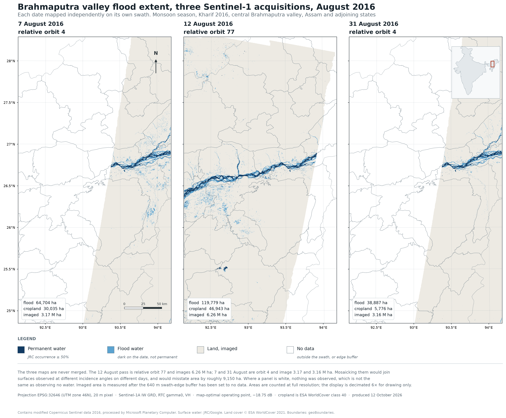

*The three acquisitions on one projection and one scale, each mapped only on
the ground its own pass saw. Where a panel is white nothing was observed,
which is not the same as observing no water. The 12 August pass is relative
orbit 77 and images 6.26 M ha while the other two are orbit 4 and image 3.17
and 3.16 M ha, which is why 7 and 31 August are compared against each other on
their shared ground rather than against 12 August. Imaged area throughout is
measured after the swath-edge buffer, about 640 m, has been set to no data.*

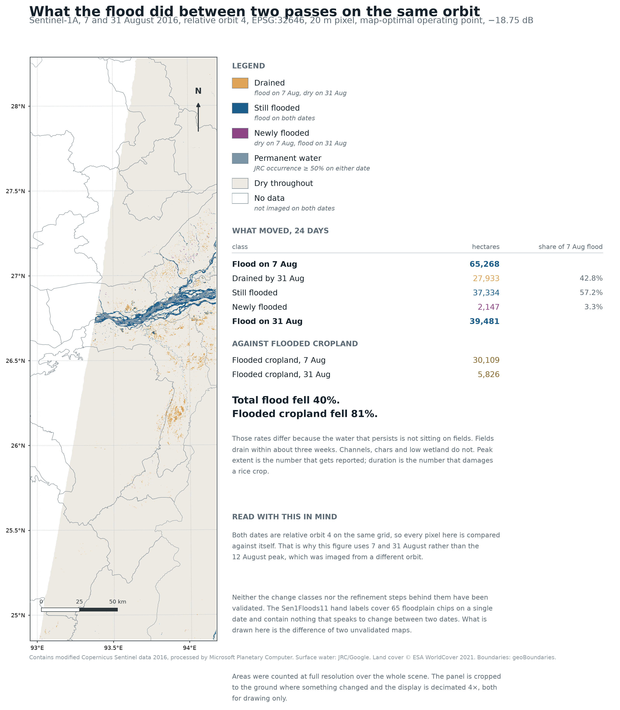

*The same relative orbit twice, 24 days apart, so every pixel is compared
against itself rather than against a different viewing geometry. Total flood
fell 40% over those 24 days while flooded cropland fell 81%. The water that
persists is in channels, chars and low wetland rather than on fields, which
drain in about three weeks. Peak extent is the number that gets reported and
duration is the number that damages a rice crop. The change classes are
unvalidated. Each map is checked on its own against Landsat in the
[independent check of the 7 and 31 August maps](#independent-check-of-the-7-and-31-august-maps),
which finds that most of the fall is water leaving fields.*

### Why the three maps are not merged into one

Filling the 12 August map's eastern gap with 7 August data would produce a
gap-free picture describing no moment that existed. The cost is
measurable rather than hypothetical. In the 1.82 million hectares both passes
saw, flood fell to 75.3% of its extent in those five days. The 7 August wedge
holds 36,915 ha, so on 12 August it would have been nearer 27,800 ha. **A naive
mosaic would have reported roughly 9,100 ha of water that had already gone**,
about 7.5% of the total, with no visible seam.

---

## How 217,490 becomes 120,790

The raw threshold output over the full scene is 217,490 ha. Three things are
dark to radar without being wet, and each was found by looking at the map rather
than by any metric.

| Step | Removed | Remaining |
|---|---:|---:|
| Raw threshold at −18.75 dB | | 217,490 ha |
| Swath edge buffer, about 640 m, to no data | 26,223 ha | 191,267 ha |
| Slope above 8° reclassified as land | 68,958 ha | 122,309 ha |
| Connected components under 10 px | 1,519 ha | **120,790 ha** |

**Swath edge.** Flood classification runs at 32.9% of area within the first
640 m or so of the frame boundary against 3.1% in the interior, measured on the
12 August map by `edge_rate.py` and written to `results/edge_rate.csv`. That is
a contrast of about eleven to one. Earlier versions of this section said 17%
and 1.9%, which came from no file and were not what the rasters say; the decay
distance beyond the buffer is still an impression rather than a measurement. The pattern is unambiguous; the mechanism is most likely incompletely
removed GRD border noise combined with falling return at near and far range, and
that attribution has not been verified against the product documentation. The
buffer becomes no data rather than land, because those pixels are unmeasured
rather than dry. It removes real water where the swath edge crosses wet ground,
and Majuli is the clearest case.

**Terrain.** Permanent water is the control: 99.5% of the Brahmaputra channel
sits below 8° of slope. The mapped flood put 36.1% of itself above that, and
24.2% above 20°, on ground where the river has 0.10% of its area. Beyond 8° the
flood class is over-represented by a factor of 18 in the 8 to 12 degree band,
rising to about 400 above 35 degrees, relative to what genuine water does.

**The DEM is resampled bilinearly.** Slope comes from the 30 m Copernicus DEM
put onto the 20 m grid. Until October 2026 that was done by nearest neighbour,
which turns the 30 m cells into a stepped surface whose risers read as slope.
Bilinear was tested against it (REVIEW S-02) and adopted. The slope cut now
removes 68,958 ha against 68,437, and the channel above 8° falls by about a
third, from 0.7% to 0.5% of it. On the labelled sample below, four points
change and all four move toward their labels: three that are surely open water,
on the valley floor at 69 to 76 m, had slopes of 10 to 11° and were cut, and
now sit under 8° and are kept, while a point at 1,634 m that is not water is now
cut. Averaging the 10 m VH onto the grid, in place of the nearest value, was
tested as well (REVIEW S-01) and not adopted. It cut the raw flood from 217,490
to 216,370 ha and changed five sample points, three toward their labels and two
away. Nearest keeps single 10 m values, which is what the threshold was tuned
on. `CHANGELOG.md` C-31 gives both runs.

**Minimum mapping unit.** A lone 20 m pixel is a noisy sample, not a mappable
flood.

---

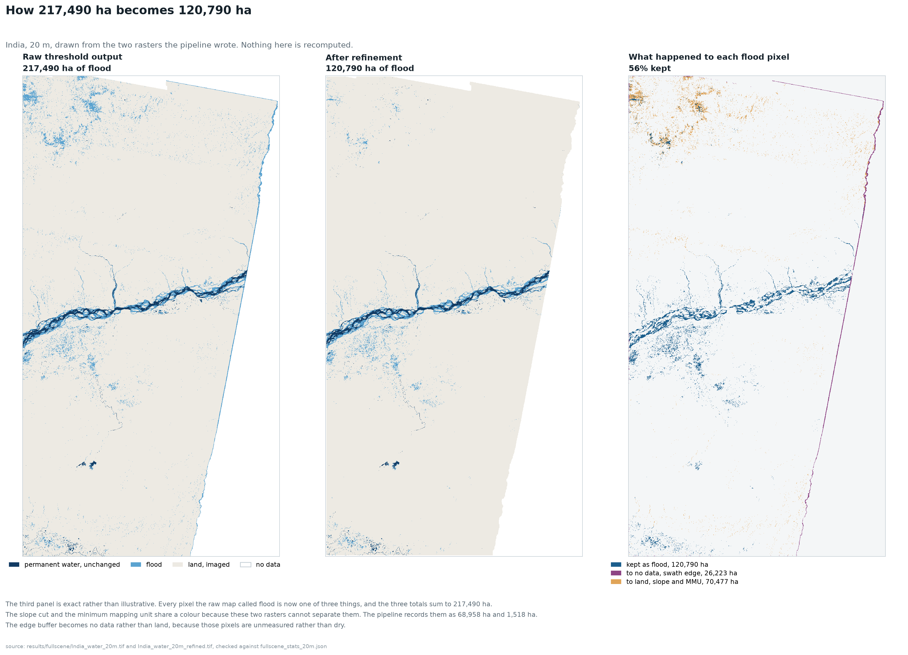

*The raw threshold output beside the refined map. Removing the swath edge, steep terrain and objects below the minimum mapping unit is what takes 217,490 ha down to 120,790 ha. The third panel is exact rather than illustrative: every pixel the raw map called flood is now one of three things, 120,790 ha still flood, 26,223 ha turned to no data inside the swath-edge buffer, and 70,477 ha turned to land under the slope cut and the minimum mapping unit. The slope cut and the minimum mapping unit share a colour because the two rasters alone cannot separate them; the pipeline records them as 68,958 and 1,519 ha.*

## Validation

Scored against Sen1Floods11 hand labels on 65 co-registered chips, using the
official train/valid/test splits, with no-data pixels excluded from every
confusion matrix.

| Method | IoU, all 65 chips | 95% CI | Precision | Recall |
|---|---:|---|---:|---:|
| This pipeline, RTC gamma0 | 0.519 | [0.395, 0.609] | 0.780 | 0.608 |
| This pipeline, on the GEE product | 0.531 | | 0.789 | 0.619 |
| Published S1OtsuLabelHand baseline | 0.531 | | 0.820 | 0.601 |

Intervals are percentile bootstrap resampled over **chips**, not pixels, because
pixels within a chip are strongly autocorrelated and resampling them would give
intervals far too narrow.

Two things the single figure hides.

**Macro IoU is 0.280** against a micro of 0.519, with a standard deviation of
0.249 and a minimum of exactly 0.000. Micro weights by pixel count, so the few
chips holding most of the water carry it. Weighting every chip equally, the
method fails outright on some of them.

**The splits are not exchangeable.** Nothing here is trained, so train, valid
and test are three samples of chips scored by one fixed threshold, and they give
0.326, 0.612 and 0.680. That spread is larger than any method difference
measured anywhere in this project, including the entire Earth Engine to RTC
migration at 0.012. An earlier version of this README quoted the test figure of
0.680. That was the highest of the three and quoting it was cherry-picking; see
`CHANGELOG.md` C-02.

Running the same code on the same product the published baseline used
reproduces its IoU to three decimal places. That is the strongest evidence here
that the implementation is correct, and it means the remaining gap is about
inputs rather than about a bug.

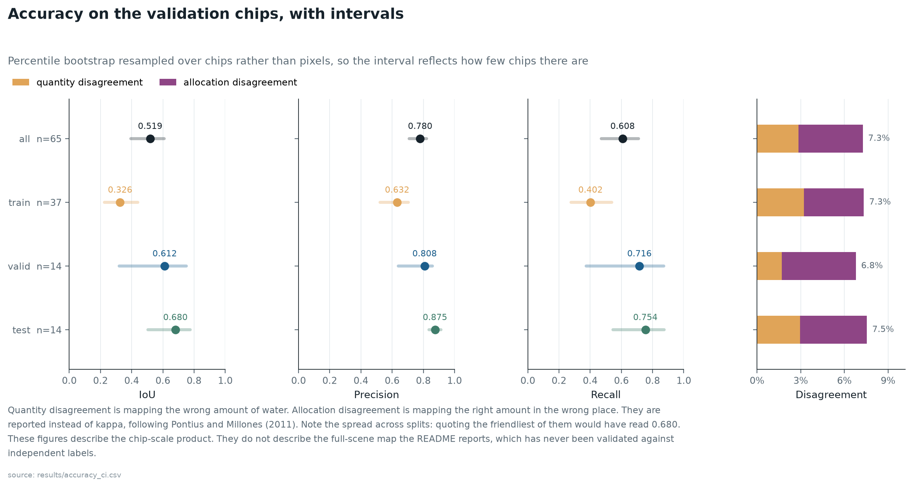

*Per-chip IoU with percentile bootstrap intervals resampled over chips rather than pixels. These figures describe the chip-scale product. They do not describe the full-scene map reported above, which the independent check below scores directly.*

### Other floods

The three splits come from one scene, so they show the threshold was not fitted
to the valid split and say nothing about another river. Sen1Floods11 has hand
labels for ten other floods. `transfer_events.py` took each through the steps
India went through: Planetary Computer RTC gamma0 read onto every chip, shifted
onto the label grid, Lee-filtered and cut at −18.75 dB, with nothing tuned.
Scored by the same code, India comes out at its 0.519 again.

| Event | Chips | IoU at −18.75 dB | 95% CI | Precision | Recall | Best threshold for the event | IoU there | Authors' per-chip Otsu |
|---|---:|---:|---|---:|---:|---:|---:|---:|
| India | 65 | 0.519 | 0.400 to 0.601 | 0.780 | 0.608 | −18.25 dB | 0.525 | 0.531 |
| Mekong | 30 | 0.764 | 0.677 to 0.822 | 0.939 | 0.804 | −17.25 dB | 0.779 | 0.780 |
| Bolivia | 15 | 0.661 | 0.434 to 0.789 | 0.753 | 0.844 | −18.50 dB | 0.661 | 0.697 |
| Nigeria | 18 | 0.639 | 0.533 to 0.732 | 0.950 | 0.661 | −17.25 dB | 0.692 | 0.643 |
| Spain | 30 | 0.612 | 0.439 to 0.721 | 0.705 | 0.822 | −20.25 dB | 0.657 | 0.670 |
| Sri Lanka | 40 | 0.568 | 0.337 to 0.724 | 0.657 | 0.807 | −21.25 dB | 0.675 | 0.649 |
| Ghana | 53 | 0.473 | 0.367 to 0.548 | 0.797 | 0.537 | −17.50 dB | 0.528 | 0.408 |
| USA | 69 | 0.412 | 0.304 to 0.509 | 0.480 | 0.745 | −20.50 dB | 0.506 | 0.508 |
| Pakistan | 28 | 0.178 | 0.087 to 0.273 | 0.205 | 0.581 | −21.75 dB | 0.255 | 0.152 |
| Somalia | 26 | 0.131 | 0.075 to 0.191 | 0.152 | 0.487 | −19.25 dB | 0.132 | 0.151 |
| **Nine others, pooled** | **309** | **0.493** | 0.432 to 0.551 | 0.599 | 0.737 | −20.25 dB | 0.529 | 0.499 |

Pooled, the threshold does about as well away from India as on it, and as well
as the dataset authors' Otsu run separately on every chip. The pooled figure
hides a range from 0.764 to 0.131. Where it fails, in Pakistan and Somalia,
precision is 0.205 and 0.152: most of what it calls water is something else,
and no single threshold fixes that, since the best for each event scores only
0.255 and 0.132. Both are dry places, and dry sand or bare soil can be as dark
as water in VH; that is the likely cause, though it has not been tested here.
The best threshold also moves from event to event, from −21.75 to −17.25 dB.
The dataset's own per-event thresholds, set on Earth Engine sigma0 and recorded
in its metadata, spread over 5.6 dB the same way. The "best" columns are fitted
to the very chips they score, so they flatter themselves. India's interval
here, 0.400 to 0.601, differs a little from the 0.395 to 0.609 above only
because the bootstrap draws differ.

Two notes on what this covers. Paraguay, the tenth event, has no Sentinel-1
scene for its date and orbit on Planetary Computer, in RTC or in the GRD it is
made from; the nearest is 5 days later on another orbit, which would score a
different flood, so it is left out (`results/transfer/probe_Paraguay.csv`).
Two Sri Lanka chips never aligned with the dataset's own imagery and are left
out, as three India chips were. Ten chips aligned at the edge of the ±5 pixel
search; without the eight in Mekong it scores 0.786.

So 0.519 is a fair figure for this method on floodplain rivers like this one,
and it is no promise for a new region. A dry landscape can break it outright,
and anyone using it elsewhere should check it there first.

### What leaving Google Earth Engine costs

The published baseline was built on Earth Engine sigma0. This pipeline uses
Planetary Computer RTC gamma0 and never touches Earth Engine. At matched recall,
each curve read at the point whose recall is nearest the baseline's 0.601, the
precision gap decomposes as:

```
moving from RTC to the GEE product     +0.024
moving from pooled to per-scene Otsu   +0.016
total gap to the published baseline    +0.040
```

So the migration costs about 0.024 of precision at matched recall, and 0.012 of
IoU with each product at its own best threshold on the valid split. An earlier
version of this section gave +0.009 and +0.031, which were the precision
differences between each curve's best-on-valid points rather than at matched
recall (C-14). Separability
explains why it is small: RTC has less contrast (6.10 dB against 7.95) but is
also less noisy (spread 3.10 against 3.89), so d-prime lands at 1.97 against
2.04. Terrain-corrected radiometry is flatter and cleaner rather than worse.

A 5×5 Lee filter is worth +0.038 IoU on its own, comparing each variant at its
own best threshold, a larger effect than the entire platform migration.

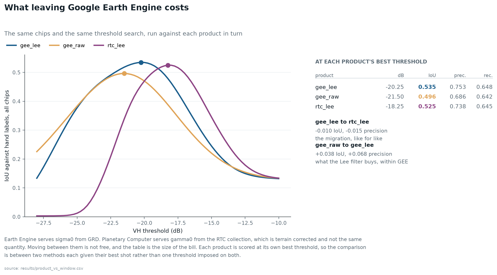

*What the move off Earth Engine costs, measured on the same chips with the same threshold search.*

### Cross-orbit agreement

Orbits 77 and 4 view the same ground at different incidence angles. The two
passes share 1,819,972 ha, and eight tiles covering 729,161 ha of that were
compared. Over land they agree to **0.05 dB**, the mean of the per-tile land
medians, each tile weighted by its land pixel count, with
**0.11 dB of scatter between tiles**, the sample standard deviation of those
same medians. One threshold serves both orbits, and
that is measured rather than assumed. For anyone building multi-orbit monitoring
on this stack it is a load-bearing fact.

---

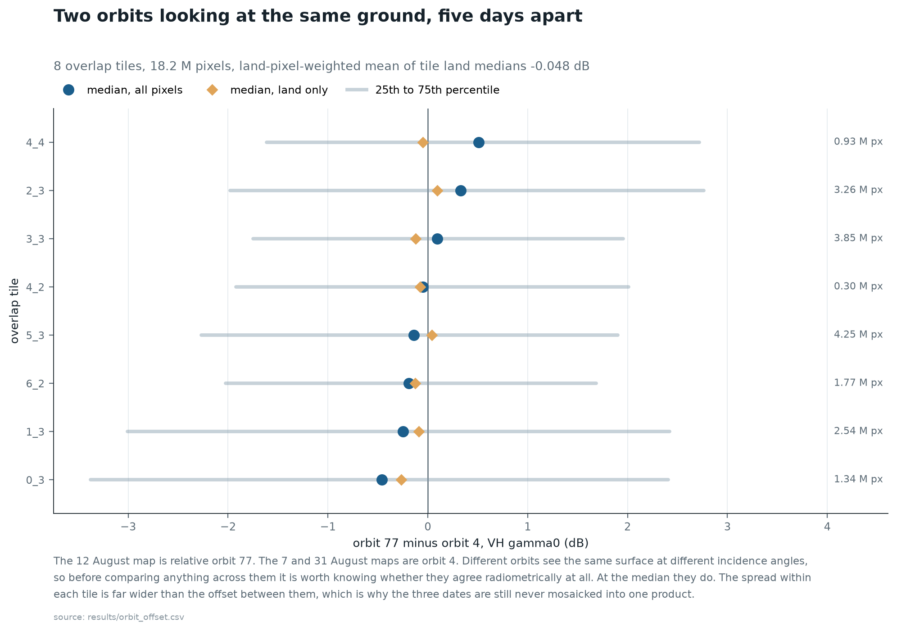

*Backscatter agreement between relative orbits 4 and 77 over the ground they share.*

---

## Independent check of the 12 August map

The accuracy above comes from 65 chips scored before the slope cut, the
swath-edge buffer and the clean-up existed. This section scores the map itself.
A stratified random sample of the 20 m map, as it stood before the DEM change
above, was labelled by eye on an optical image of the same day, and the labels were turned into an area estimate
with a standard error by the stratified estimator of Olofsson et al. (2014).
Every step is in `src/`, and every number below is in `results/validation/`.

**Reference image.** Sentinel-2A imaged the study area at 04:15 UTC on 12
August, about twenty hours before the Sentinel-1 frames at 23:46 UTC, while the
flood was receding. Cloud covers much of the scene, so points were drawn only
where the scene classification shipped with the image shows no cloud, cloud
shadow or cirrus within 100 m, and only where a test on the image itself found
no cloud or haze within 100 m. The classification's dark-area and unclassified
pixels count as eligible. Counting all three top-ups, 167 points sit on them
and 62 of those were labelled open water, so leaving them out would have
hidden much of the flood. "Clear" below means eligible in this sense. The classification misses
some cloud outright, and the image test removed 41 of the 591 candidates it had
passed. Two earlier draws were set aside before their labels were used: the
first let points through at cloud edges, and the second put one inside a cloud
bank the classification had missed. One point of the second draw had been
labelled. Both earlier keys, that label and a log of every draw are kept in
`results/validation/sample/`.

**Design.** Seven strata, read off the map as it was drawn on. They stay as
drawn, since every point's weight comes from them, and the published map is
scored against the same points (below):

| Stratum | Mapped ha | Eligible ha sampled | Points |
|---|---:|---:|---:|
| Flood at −18.75 dB | 119,779 | 46,582 | 100 |
| Permanent water | 58,389 | 30,417 | 40 |
| Flood at −17.75 dB only | 50,847 | 20,258 | 80 |
| Removed by the slope cut or the clean-up | 70,686 | 9,438 | 60 |
| Swath-edge buffer | 79,785 | 20,429 | 50 |
| Land within about 1 km of flood | 1,428,300 | 560,868 | 100 |
| Land further from flood | 4,536,775 | 1,566,047 | 120 |

A further 60 points went to the floodplain part of the last stratum, where the
first pass put only 7. Later, 150 more went to the floodplain part of land
within about 1 km of flood, which held 624,310 ha of the floodplain and only 44
readable points, and carried most of the headline's variance. The first interpreter labelled every point, in random
order and without the map: W for open water, V for water seen through vegetation, N for
not water and C for unreadable, each with a confidence from 1 to 3. 21 of the
main sample were unreadable.

**Where the estimate holds.** Clear sky is not spread at random. Under cloud,
the land strata are far higher and steeper than where the sample could see, so
the headline is restricted to the floodplain: ground at or below 150 m with a
slope of 2° or less, which held 102,697 of the 119,779 ha mapped as drawn.
Inside it
the clear and cloudy parts agree on slope in every stratum, with standardised
differences of 0.13 or less, though the cloudy part lies about 10 m lower and
so further downstream.

**Open-water flood inside the floodplain.**

| | Open-water flood | Mapped at −18.75 dB, as drawn | Mapped at −17.75 dB, as drawn |
|---|---:|---:|---:|
| Clear part only | 59,172 ± 6,204 ha | 42,419 ha | 60,357 ha |
| All of the floodplain | **135,505 ± 13,221 ha** | 102,697 ha | 146,367 ha |

The 95% interval for the whole floodplain runs from 109,593 to 161,417 ha. At
−18.75 dB, 0.73 of what the map calls flood is open water, ± 0.05, and the map
finds 0.55 of the open water there, ± 0.05. At −17.75 dB the two figures are
0.60 and 0.64. Lowering the floodplain ceiling to 100 m gives 130,769 ha.
Raising it to 200 m gives 157,603 ha, but that figure cannot use the top-ups,
which were drawn inside 150 m, so it rests on the main sample alone in those
strata. The map is fairly reliable where it says flood and misses close to
half of it, and the true figure lies between the two thresholds.

**The published map.** With the bilinear DEM the map holds 102,758 ha of flood
in the floodplain at −18.75 dB and 146,400 ha at −17.75 dB. No floodplain point
changes class, so its accuracies there are the ones above. Over the whole map,
where the three valley-floor points are now kept, user's accuracy goes from
0.740 to 0.755 and producer's from 0.421 to 0.439, both well inside their
standard errors. `score_map.py` reads each version of the map at the sample
points and scores it with the estimator for strata that differ from the map
classes (Stehman, 2014), since a changed map cuts across the strata it was
drawn with. On the map as drawn it reproduces the figures above exactly.

**The refinement steps.** Of 57 readable points in what the slope cut and the
clean-up removed, 6 were water and 5 of them open water: about 6,201 ± 2,672 ha
of the 70,686 ha removed was real open water. Three of those five are the
valley-floor points the bilinear DEM now keeps. Inside the swath-edge buffer 1 of
45 readable points was flood, seen through vegetation and marked as a guess. One
more was open water on ground JRC counts as permanent, which is not flood by
this project's definition. The buffer set aside very little real flood.

**Water under vegetation is reported apart.** Counting V as flood nearly
triples the estimate, to 400,861 ± 23,933 ha in the floodplain. It stays out of
the headline. In August the valley's rice paddies normally stand in water, and
V is common well away from mapped flood: 10 of 67 points in floodplain land far
from it, and 62 of 194 in floodplain land near it, where only 14 were open
water. A C-band VH threshold cannot see water under a crop canopy in any case.

**A second reader.** The 62 points the first reader marked as guesses, outside
permanent water, were labelled again along with 40 drawn at random from the
rest, mixed and renumbered so nobody could tell which set a point came from. A
second person labelled them blind to the first labels and to the map, and
Claude did the same separately. On the random points the second person agreed
with the first on 0.925 of them, a kappa of 0.856, and the kappa for open water
against everything else was 0.857. On the guesses it fell to 0.542. Claude's
kappa with the first reader was 0.736 on the random points and 0.461 on the
guesses.

The 150 top-up points came later, and the first reader labelled them
differently: none was marked as a guess, where 18 of the 100 points near flood
in the main sample had been, and 50 were called V, against 19 there. So 40 of
them were drawn at random for a second reading, along with the 8 others the
first reader called open water. On the random 40 the second person agreed with
the first on 0.875 of them, a kappa of 0.776, about as well as on the main
sample. Of the 8 open-water calls she kept 6 and Claude 3. Every other point
keeps the first reader's label in the table below.

| Labels on the relabelled points | Open-water flood in the floodplain | Counting V as flood |
|---|---:|---:|
| First reader | 135,505 ± 13,221 ha | 400,861 ± 23,933 ha |
| Second person | 123,996 ± 12,133 ha | 398,999 ± 24,034 ha |
| Claude | 118,349 ± 11,708 ha | 396,059 ± 23,959 ha |

The first reader again called more of the hard cells open water than either of
the others, so the headline is the top of what different readers give, and the
gap between readers is about as large as the standard error. Over the whole
map, which leaves the top-ups out, the second person's labels move open-water
flood from 210,547 to 195,493 ha. Every reading finds more open water in the
floodplain than the 102,758 ha mapped at −18.75 dB and less than the 146,400 ha
at −17.75 dB. Claude's labels are an AI's reading of the same chips, not a
third person's. Each chip shows the point's original number in its title, so
the renumbering hid the order and the set a point came from, though not which
point it was; neither second reader had the first labels to hand.

What this check does not cover:

- **Readers.** Only the relabelled points have a second reading. The standard
  errors above cover sampling alone, and on the hard points the readers differ
  by about as much again. The first reader also knew that every top-up point
  came from near mapped flood, which the main sample did not reveal.
- **Cloud.** On the map as drawn, 60,278 of the 102,697 ha of flood in the
  floodplain, 58.7%, lay under cloud. The whole-floodplain figure assumes the
  map errs there as it does in clear sky. The terrain check backs that on
  slope, less so on elevation: the cloudy part lies about 9 m lower in the flood
  stratum and 11 m lower in permanent water. The ± leaves this out, and the
  clear part alone gives 59,172 ± 6,204 ha.
- **Timing.** The optical image is about twenty hours earlier than the radar
  while the flood was receding, which pushes the optical estimates up a little.
  Map land was water at between 20.4% and 27.0% of points whatever the distance
  to the nearest cloud, so the sample shows no trend with cloud.
- **Outside the floodplain.** Checked below, on far fewer points. Stretching
  the clear-sky rates across the whole map gives 210,547 ± 37,549 ha of open
  water, a figure the terrain difference makes untrustworthy.
- **The other dates.** Checked in the next section, on Landsat images that are
  coarser and three days earlier.

The image chips sit under `data/validation/chips/` and are not committed;
`draw_sample.py --chips-only` rebuilds them from the key.

### Outside the floodplain

The rest of the 12 August map splits in two on the same DEM: ground at or below
150 m that the DEM calls steeper than 2°, and ground above 150 m.
`score_map.py` scores each with the main-sample points that fall in it.

**Low ground the DEM calls sloped.** It holds 8,801 ha of flood on the map as
drawn and 9,551 ha on the published map, and 84 points, 18 of them open water.
Every point the map called flood there was open water, 8 on the map as drawn
and 11 on the published map, but in the clear part
the map found only 0.263 ± 0.120 of the open water: 14,732 ± 6,747 ha on the
ground against 3,874 ha mapped. 16 of the 18 open-water points lie between 57
and 81 m, on the valley floor, and the 30 m DEM gives them slopes of 2 to 15°.
Five of them are among the points the slope cut removed. So this is mostly
valley floor that only the DEM's slope puts outside the floodplain, and the map
misses most of its water. Stretched over the cloudy part it comes to 32,258 ±
14,844 ha.

**Above 150 m.** The map as drawn holds 8,282 ha of flood here and the
published map 8,481 ha, but only 280 ha of it lay under clear sky, where the
main sample put one point. A third top-up added 30 points in that clear flood.
Of the 30 readable, 21 are open water, so 0.700 ± 0.085 of what the map calls
flood above 150 m is open water, and 0.778 ± 0.081 on the published map. The
open water sits on flat ground, at 159 to 718 m with a median of 230 m and a
median slope of 0.5°. The eight top-up points labelled not water lie much
higher, at 263 to 3,081 m with a median of 1,219 m and a median slope of 3.4°,
and the main sample's one point there, at 1,634 m, was not water either. The
false flood up here is in the mountains. Stretched over the cloudy part, open
water comes to 5,797 ± 705 ha against 8,282 ha mapped, a figure that rests on
280 clear hectares.

**What finding nothing rules out.** None of the 94 readable points in land far
from flood above 150 m was open water. The estimator then gives that stratum no
missed flood and no variance, and the map's producer's accuracy above 150 m
comes out as 1.000 ± 0.000. That says only that none was found. At the 95%
bound, up to 3.85% of the stratum's 1,191,667 clear hectares could be open
water, about 45,859 ha. On low sloped ground the same stratum has only 12
readable points and the bound is 49,430 ha. `score_map.py` writes this bound
for every group with no open water found to `zero_hit_bounds.csv`.

The same holds the other way round. On low sloped ground every point the map
calls flood is open water, so its user's accuracy prints as 1.000 ± 0.000. That
too says only that no false flood was found, among 8 points on the map as drawn
and 11 on the published map. At the 95% bound user's accuracy there could be as
low as 0.631 or 0.715. `score_map.py` writes this bound, for a user's accuracy
of exactly 1 or exactly 0, to `user_accuracy_bounds.csv`, and every row of
`map_scores.csv` now carries the number of readable points behind it.

---

## Independent check of the 7 and 31 August maps

No Sentinel-2 scene near either date has usable sky (`scene_inventory.py
--map-date`). Landsat does. `landsat_clear_sky.py` puts each scene's QA band on
the map grid: the Landsat 7 scene of 4 August sees 66.4% of the 7 August map's
flood under clear sky, and the Landsat 8 scene of 28 August sees 38.0% of the
31 August map's. Each map got a stratified sample of 300 points from
`date_sample.py`, in the same seven strata, read from that date's published
maps. Points fall only where the QA band shows clear sky with no cloud, cirrus
or shadow bit within 100 m, and the image test from 12 August, carried over to
Landsat reflectance, rejected none. That left 41,600 of the 65,356 ha of flood
mapped on 7 August eligible, and 12,974 of the 39,481 ha on 31 August. The
first reader labelled both samples blind, as before. A second person later
relabelled 145 points on each date (below).

These checks are weaker than the 12 August one in two ways. Both images were
taken three days before the radar rather than twenty hours, while the flood was
receding, so they probably show more water than the radar saw. That pushes
user's accuracy up and producer's accuracy down. And Landsat pixels are 30 m
against the map's 20 m, so a pixel mixing water and crop is easier to read as
water through vegetation.

**Open-water flood inside the floodplain, −18.75 dB.**

| Map | Mapped | Open water, clear part | Open water, all of the floodplain | User's accuracy | Producer's accuracy |
|---|---:|---:|---:|---:|---:|
| 7 August | 58,286 ha | 22,927 ± 2,676 ha | 35,865 ± 4,187 ha | 0.566 ± 0.069 | 0.920 ± 0.033 |
| 12 August, published | 102,758 ha | 59,172 ± 6,204 ha | 135,505 ± 13,221 ha | 0.725 ± 0.047 | 0.550 ± 0.052 |
| 31 August | 33,768 ha | 11,274 ± 3,254 ha | 27,717 ± 6,235 ha | 0.542 ± 0.073 | 0.660 ± 0.140 |

On both dates a little over half of what the map calls flood in the floodplain
is open water, below the 0.725 of 12 August, but the rest differs. Of the 60
points in the 7 August map's flood, 34 are open water, 23 water through
vegetation and 3 not water, and 18 of the 23 sit where JRC never recorded
water, so they are fields. Of the 31 August map's 60, 32 are open water, 2
water through vegetation, 25 not water and 1 unreadable, and 20 of the 25 sit
where JRC records water between 1 and 49% of the time, the river's seasonal
bed. Wet sand and silt left by the falling river could be dark enough to the
radar to pass the threshold, and so could water that came back between 28 and
31 August; the sample cannot tell the two apart. Counting water through
vegetation as flood, 0.962 of the 7 August map's floodplain flood is wet,
against 0.583 on 31 August.

The 7 August producer's accuracy is weaker than its ± suggests. None of the 36
readable floodplain points in land near flood was open water, so that stratum
adds nothing to the estimate or to its variance. At the 95% bound it could hold
16,341 clear hectares of open water, which would bring the clear-part
producer's accuracy down to about 0.54. On 31 August only two points fell in
floodplain land far from flood, and the bound there allows up to 75,300 ha.

Outside the floodplain these samples have few points. No point fell in either
map's flood above 150 m at −18.75 dB. At −17.75 dB three did on 7 August and
one on 31 August, none of them open water, so user's accuracy there prints as
0.000 ± 0.000 when the bound allows up to 0.708 and 0.975
(`user_accuracy_bounds.csv` in each sample folder). On low sloped ground, 42 points on 7 August and 66 on
31 August give user's accuracies of 0.571 ± 0.202 and 0.545 ± 0.158.

**Clear sky against cloud.** `date_checks.py terrain` repeats the 12 August
terrain check on both dates. Inside the floodplain the clear and cloudy parts
agree on slope, with standardised differences of 0.24 or less. On elevation, 7
August looks like 12 August: the clear part lies 1 to 12 m higher, with
differences of 0.23 to 0.42. On 31 August the gap is larger. The clear part of
the flood stratum lies 6 m higher, a difference of 1.02, and that of permanent
water 10 m higher, 1.70. On the valley floor, lower ground usually lies further
downstream, so on 31 August cloud probably covered a different stretch of the
river from the one the sample saw. Its clear-part figure, 11,274 ± 3,254 ha of
open water against 11,432 ha mapped, covers about a third of the map's
floodplain flood and needs no assumption about cloud. The whole-floodplain
27,717 ha stretches it over ground it stands in for poorly. Over the whole map
the land strata under cloud are far higher and steeper on both dates, as on 12
August.

**A second reader.** `date_checks.py second` took every 7 August point in the
map's flood and in "upper threshold only", 105 in all, since those calls set
user's accuracy, and 40 more at random from the rest. They were mixed,
renumbered and cut again as chips under the new numbers, and a second person
labelled them blind to the first labels and to the map. On the 105 she agreed
with the first reader on 0.876 of them, a kappa of 0.787, and 0.857 for open
water against everything else. On the random 40 she agreed on 0.975, a kappa of
0.847. Of the 56 points the first reader called water through vegetation, she
called 49 the same, 2 open water, 4 not water and 1 unreadable. With her labels
on those points, open water in the floodplain moves from 35,865 to 34,776 ±
4,111 ha, user's accuracy from 0.566 to 0.577 and producer's accuracy from
0.920 to 0.967. So the finding that much of the 7 August map's flood is water
standing in crops does not rest on one reader. Both readers saw the same 30 m
pixels, so this says nothing about pixel size.

On 31 August the same design drew 145 points again, numbered and cut afresh.
On the 105 she agreed with the first reader on 0.876 of them, a kappa of 0.787,
by coincidence the same as on 7 August, and 0.902 for open water against
everything else. On the random 40 she agreed on 0.950, a kappa of 0.812. Of the
49 points the first reader called not water, she called 47 the same. In the
map's flood stratum she called 29 of the 60 not water, against the first
reader's 25, so the finding that much of the 31 August map's flood is dry
ground holds. With her labels, open water in the clear part of the floodplain
falls from 11,274 to 8,713 ± 2,403 ha against 11,432 ha mapped, over the whole
floodplain from 27,717 to 22,551 ± 4,790 ha, and user's accuracy from 0.542 to
0.500.

**What this does to the recession.** The two maps share a footprint, so their
floodplain estimates compare directly. Open water fell from 35,865 ± 4,187 ha
to 27,717 ± 6,235 ha on the first reader's labels, about one standard error
of the difference. On the second person's it fell from 34,776 ± 4,111 ha to
22,551 ± 4,790 ha, about two. So whether the samples show open water falling at
all turns on who reads the hard cells. Counting water through
vegetation, wet ground fell from 165,112 ± 34,321 ha to 38,283 ± 8,286 ha. Most
of the fall in mapped flood is water leaving fields, which fits the 81% fall in
flooded cropland above. Both figures stretch clear-sky rates over cloud, and
on 31 August the terrain check shows that stretch to be weak, so the
comparison is less certain than its standard errors say.

What this check does not cover:

- **Readers.** A second person relabelled 145 points on each date, every
  point in mapped flood and "upper threshold only" among them. The rest keep
  one reading.
- **Timing and pixel size.** The three-day gap and the 30 m pixels are stated
  above and not measured.
- **The chips** sit under `data/validation/chips_20160807/` and
  `chips_20160831/`, are not committed, and `date_sample.py chips` rebuilds
  them from the key.

---

## What was tried and rejected

### Change detection does not work here

The textbook approach is to difference the flood date against an earlier
reference. It was tested against two references and abandoned.

| Reference | Already wet | IoU | Recall |
|---|---:|---:|---:|
| 19 July 2016, mid-monsoon | 45.1% | 0.069 | 0.086 |
| 14 April 2016, pre-monsoon | 18.7% | 0.178 | 0.295 |
| Single date, no reference | | **0.515** | 0.709 |

*Already wet* is the median share of hand-labelled water that was already at or
below the water threshold on the reference date, measured on Lee-filtered
references as the method sees them (`results/reference_wetness.csv`). The
same file gives the unfiltered shares, about ten points higher, which are
close to what `dry_reference.csv` reports over 63 chips.

Sweeping the change threshold from −12 to +4 dB across four smoothing windows
and both gate settings found the optimum at the point where the change
constraint stops excluding anything. **The best available change configuration is
the one that ignores the change signal.**

With the change signal alone the best the sweep reaches over all 65 chips, test
split included, is IoU 0.196, at a required drop of 2 dB. Chosen on the valid
split instead, as every other setting here is, it reaches 0.146. Relax the
required drop to nothing and every change-only configuration, the absolute
gate off, converges on about 0.13, 0.129 for that one, which is what labelling
the entire scene as water scores.

The reason is measurable. At thresholds where the filter actually bites it
deletes true water faster than false positives: requiring a 3 dB drop removes
66% of the true water the single-date threshold found and 46% of its false
alarms. Between April and August, 46.6% of the labelled ground on the chips
darkened by 0.5 dB or more, because the monsoon wet everything, while
hand-labelled water, the river included, covers 13% of it
(`results/change_filter_rates.csv`). The change signal is mostly a seasonal
wetting map with the flood buried inside it.

A related trap: Otsu on a difference image picks a threshold close to zero,
because a difference image has one mode rather than two. Most pixels did not
change, so their difference is speckle minus speckle piled around zero, and the
changed pixels sit in a tail rather than a second peak.

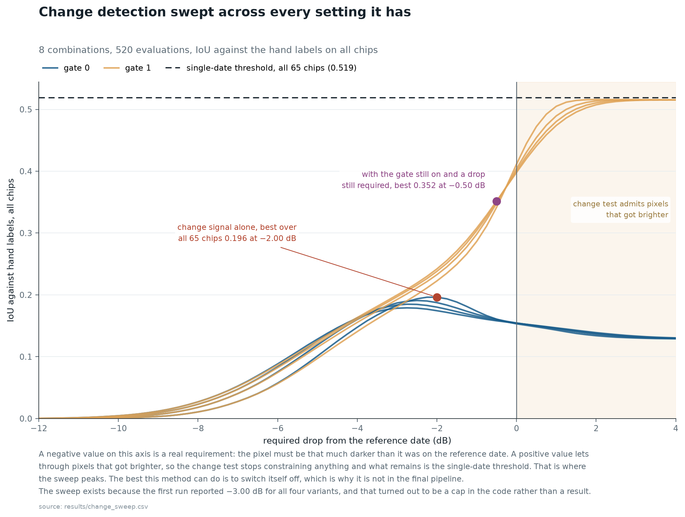

*Change detection swept across the full range of drop thresholds. Nothing in the sweep beats thresholding the flood image on its own, which is why change detection is not in the final method.*

### A slope mask does not help on the validation chips

Swept from 2° to 20°, it moved precision +0.008 for recall −0.003. That result is
correct about the chips and wrong about the scene, and the next section explains
why.

---

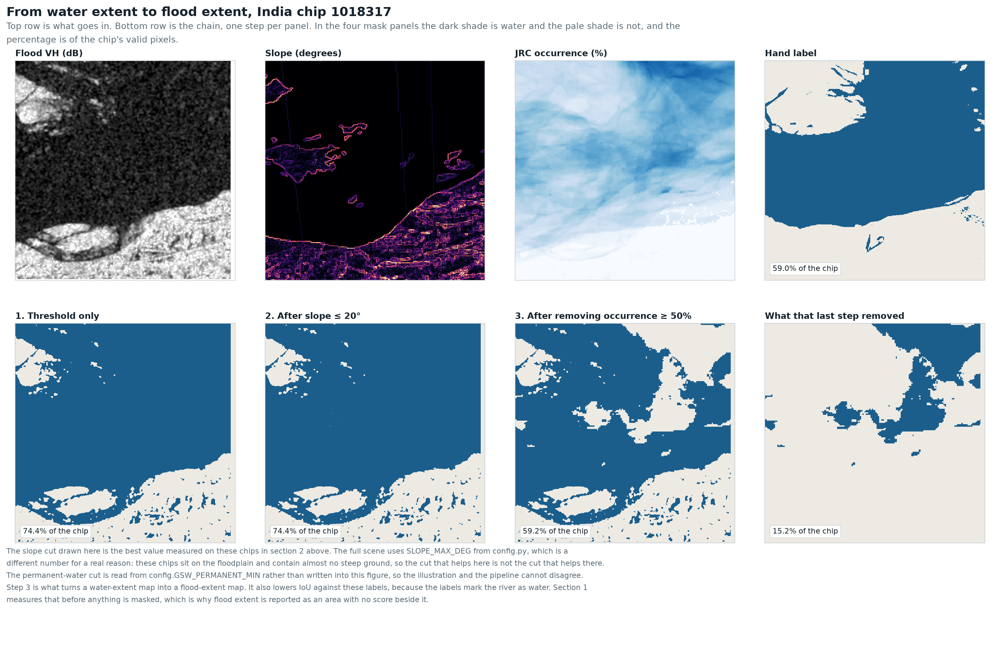

*The chain on a single chip. The top row is what goes in: the flood-date VH image, slope, JRC occurrence and the hand label. The bottom row is each step in turn, threshold alone, then the slope cut, then permanent water removed, then what that last step took out. The slope cut drawn is the best value measured on these chips, which is not the value the full scene uses, and the section above explains why.*

## Where the answer moves without the method changing

Four places, all measured on this event.

| Choice | Range | Effect |
|---|---|---|
| Change-detection reference date | 19 July vs 14 April | 6,161 ha vs 17,575 ha |
| Permanent water definition | JRC occurrence 10% to 90% | 8,893 ha to 19,458 ha |
| Terrain cut | none to 2° | 191,268 ha to 105,588 ha |
| Acquisition date | 7 Aug vs 31 Aug, same ground | 65,268 ha to 39,481 ha |

The terrain-cut row is read from `results/sensitivity_grid.csv`, which is
computed after the swath-edge buffer and before the minimum mapping unit. Both
of its numbers therefore sit one step short of the reported 120,790 ha.

Every one of those is a choice an analyst makes silently and a reader never
sees. On this river the number moves more with the definitions than with the
algorithm.

---

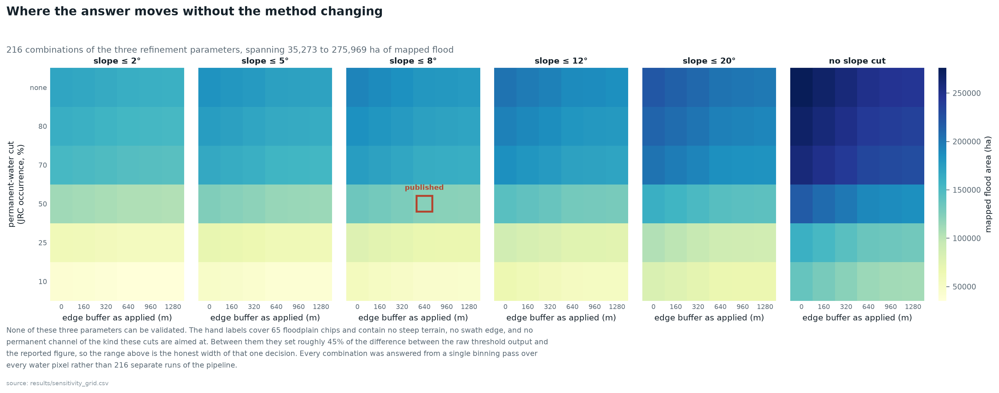

*Mapped flood area across all 216 combinations of slope cut, occurrence cut and edge buffer, answered from a single binning pass over every water pixel rather than 216 separate runs.*

## Three times a conclusion did not survive the full scene

Every finding above from the validation chips was measured correctly and three
of them still failed when the pipeline moved from 65 chips to 63,000 km². All
three failures have the same shape: the validation set was selected around the
flood, so it represents the flood rather than the region.

1. **Otsu window.** Per-scene threshold estimation, worth +0.016 precision on a
   floodplain scene, returned −15.36 dB when run over the whole 200 × 381 km
   rectangle, 3.4 dB too permissive, classifying 53% of the imaged area as
   flood. The AOI contains hills and dry upland the labelled chips never
   sampled.
2. **Slope mask.** Neutral on the chips, because all 65 sit in the floodplain
   and there are no mountains in the validation set. On the full scene it
   removes 68,958 ha of hillside radar shadow.
3. **Swath edge.** Never visible in chip-scale validation at all, because chips
   are interior. It contributed about 26,000 ha of the raw scene total.

All three were caught by looking at the rendered map, not by a metric. That is
worth stating plainly: no score in this repository would have found any of them.

---

## Limitations

- **The study area covers part of Assam and land beyond it.** The AOI comes from
  the Sen1Floods11 chip footprints. Of the four districts named as worst
  affected on the International Water Management Institute's Sentinel-1 flood
  map of 4 August 2016, made from ESA data and posted on
  [ReliefWeb](https://reliefweb.int/map/india/mapping-floods-assam-india-using-sentinel-1-satellite-images-04-august-2016), it contains two,
  Golaghat and Jorhat, and misses two that lie on either side of it: Bongaigaon
  at 90.4 to 90.9°E and Dhemaji at 94.2 to 95.5°E. Sivasagar, Dibrugarh,
  Tinsukia and Barpeta are also outside. In the other direction the swath
  crosses into Nagaland, Meghalaya, Arunachal Pradesh and Manipur, so the
  district table contains Dimapur, the Jaintia Hills districts, Papum Pare and
  Imphal East among others. Any comparison against an Assam state figure must
  first restrict the sum to Assam districts, which needs a state label the
  current district table does not carry.

- **The headline is an uncorrected map pixel count and is probably low.** At the
  operating point used for the full scene the map recovers 14,405 ha of the
  18,483 ha of hand-labelled water, a shortfall of 22.1%. Scaling the reported
  figure by that ratio gives about 155,000 ha. The scene also drops water patches
  and fills holes under 1 ha before counting, a step the chips were scored
  without. With it, at that 1 ha limit, the chips recover 13,266 ha, a
  shortfall of 28.2%, and the same scaling gives about 168,300 ha. Chip error
  rates should not
  be assumed to hold over terrain the chips never sampled. The independent
  check above confirms the direction for open water in the floodplain, with a
  standard error. See `REVIEW.md` F-01 and F-02.

- **No external validation was obtainable.** No contemporaneous district-wise
  inundation product for this event could be retrieved from open archives. The
  ASDMA report archive begins in 2017 and the site was unreachable; the NRSC
  Flood Hazard Zonation Atlas is a multi-year frequency product rather than an
  annual record; and the flood chapter of the Economic Survey, Assam 2016-17
  covers flood control works and expenditure rather than event damage. Beyond
  the 65 hand-labelled chips and the labelled sample described above, nothing
  checks this map. The only external
  cross-check available is of ranking rather than magnitude, and it is loose.
  The worst-affected list on the IWMI map sits in its text and is credited to
  ASDMA figures as of 1 August, so it ranks districts by people affected, six
  days before the 7 August scene. ASDMA's district counts for 25 July, quoted
  in an [ACAPS briefing note of 3 August 2016](https://www.acaps.org/sites/acaps/files/products/files/20160803_acaps_briefing_note_update_india_floods.pdf), put Dhemaji, Jorhat,
  Golaghat and Lakhimpur above 100,000 people each. The three of those inside
  the study area hold the top places in the 7 August flooded-cropland table,
  Golaghat first, then Lakhimpur and Jorhat. Majuli was part of Jorhat until
  it became a district on 8 September 2016, so ASDMA's July count for Jorhat
  includes it; Jorhat and Majuli together hold about 5,075 ha of flooded cropland,
  still third behind Lakhimpur's 5,611 ha. That agreement is about which
  districts were hit and carries no information on hectares. For scale, the same Economic
  Survey gives Assam's average annual flood-affected area as 9.31 lakh hectares
  across the whole state and a whole season; the 120,790 ha here is one
  satellite pass on one day over part of the state.
- **Land cover date.** ESA WorldCover exists for 2020 and 2021 only. The
  cropland layer is four to five years after this flood and there is no open
  10 m alternative for India in 2016. Land that changed use in between is
  misattributed. The fetched tiles also cover 97.8% of the grid rather than all
  of it, and the uncovered 2.2% is counted as not cropland, so every cropland
  figure here is a floor.
- **District boundaries.** Present-day geoBoundaries ADM2. Assam has created
  districts since 2016, so these will not match a 2016 government bulletin one
  for one.
- **No independent validation of the district figures.** The Sen1Floods11 labels
  cover 65 chips. Nothing here has been checked against Assam State Disaster
  Management Authority bulletins for August 2016, and that comparison is the
  obvious next step for anyone using these numbers.
- **Resolution.** Run at 20 m. The pipeline is resolution-agnostic and 10 m over
  the full AOI is roughly four hours of runtime.
- **Residual false positives.** Scattered water remains in the north-west on
  ground gentle enough to pass the 8° cut. Some of it is probably genuine
  wetland and some is probably shadow in low hills. It has not been separated.
- **Outside India.** 9,698 ha of mapped flood falls outside any Indian district
  polygon, in Bangladesh, Bhutan and the Arunachal border strip.

---

## Data

All open, all licensed for reuse. No proprietary or client data of any kind.

| Layer | Source | Licence |
|---|---|---|
| Sentinel-1 RTC gamma0 | Microsoft Planetary Computer | Modified Copernicus, free reuse |
| Copernicus DEM GLO-30 | Planetary Computer | ESA, free reuse |
| JRC Global Surface Water | Pekel et al. 2016, Planetary Computer | Open |
| ESA WorldCover 2021 | Planetary Computer | CC BY 4.0 |
| Sen1Floods11 labels | Cloud to Street / Google, public GCS bucket | CC BY 4.0 |
| District boundaries | geoBoundaries ADM2, India | CC BY 4.0 |

Imagery is read through STAC with windowed COG requests. No scene is ever
downloaded whole.

Every raster is on a 20 m grid in UTM zone 46N (EPSG:32646), and every area is
a pixel count on that grid. UTM preserves shape and lets area drift a little:
over the mapped flood its area scale runs from 0.9992 to 0.9995, so each hectare figure here is about
0.07% below the area on the ground, 88 ha on the 12 August headline
(`area_scale.py`). No figure is corrected for it.

---

## Running it

Run everything from this folder, `01-sentinel1-flood-extent/`. The
requirements files sit here too.

```bash
python -m venv .venv
.venv\Scripts\activate          # Windows
source .venv/bin/activate        # macOS and Linux
pip install -r requirements.txt
```

Pipeline order. Each script prints what it found and why it matters, and writes
a CSV beside its figure.

| Stage | Script | What it does |
|---|---|---|
| Setup | `config.py`, `chips.py`, `metrics.py` | Every decision with its reasoning; shared I/O and one scoring implementation |
| 1 | `find_scenes.py` | Locate acquisitions for every Sen1Floods11 event |
| 2 | `fetch_labels.py` | Hand labels and official splits |
| 3 | `explore_chips.py` | Inventory, and score the published baseline |
| 4 | `mask_chips.py` | Nine threshold variants, ablated |
| 5 | `threshold_analysis.py` | Class separation and threshold sweep |
| 6 | `ceiling_analysis.py` | Decompose the accuracy ceiling |
| 7 | `fetch_reference.py`, `coregister.py`, `shift_field.py` | RTC onto chip grids, and align each chip to the label grid (median shift 2 px, up to 11 px) |
| 8 | `fetch_dem.py`, `mask_terrain_water.py` | Terrain and permanent water |
| 9 | `change_detect.py`, `fetch_dry_reference.py`, `change_sweep.py` | Test change detection and reject it |
| 10 | `operating_point.py`, `product_vs_window.py` | Choose an operating point; price the GEE migration |
| 11 | `full_scene.py`, `refine_scene.py`, `refine_figure.py` | Full scene, tiled and resumable. Artefact removal and the before and after figure |
| 12 | `district_stats.py`, `cropland_scene.py` | Flooded cropland by district, and scene-wide |
| 13 | `find_swaths.py`, `orbit_offset.py`, `compare_dates.py` | Second and third acquisitions, cross-orbit check, date comparison |
| 14 | `make_map.py`, `make_date_maps.py`, `make_figures.py` | Publication map at 300 dpi, the three-date and recession sheets, and the charts the README carries |
| Audit | `accuracy_ci.py` | Confusion matrix, per-class accuracy, bootstrap intervals |
| Audit | `sensitivity_grid.py` | Reported area across all 216 refinement parameter combinations |
| Audit | `make_manifest.py` | File counts, sizes and SHA-256 digests for reproduction checking |
| Audit | `edge_rate.py` | Flood called inside the swath-edge buffer against the interior |
| Audit | `area_scale.py` | How far the UTM grid's hectares sit from hectares on the ground |
| Audit | `cropland_scene.py` | Flooded cropland over the whole raster rather than over district polygons |
| Audit | `refine_figure.py` | The before and after of refinement, rebuilt from the two rasters |
| Audit | `verify_all.py` | Traces the figures in README.md and docs/index.html back to results/ |
| Audit | `register_checks.py` | The Lee noise term, the clean-up step at chip and scene scale, and the frame lookup, each against a bar set before running |
| Audit | `preflight.py` | Pre-publication checklist: scripts parse, constants match the text, the manifest and the verify report are current |
| Check | `scene_inventory.py` | Free optical scenes around 12 August, or with `--map-date` around 7 or 31 August, and their cloud |
| Check | `landsat_clear_sky.py` | Landsat QA on the map grid, and clear sky over the 7 and 31 August maps |
| Check | `clear_sky.py` | Sentinel-2 scene classification on the map grid, and clear sky per stratum |
| Check | `draw_sample.py`, `topup_sample.py` | The stratified sample with its image screen and chips, and the floodplain top-up |
| Check | `screen_points.py` | The brightness measurements the image screen's cutoffs were chosen from |
| Check | `label_tool.py` | Labelling by keyboard, blind to the map |
| Check | `transfer_events.py` | The India threshold on the hand-labelled chips of nine other Sen1Floods11 floods |
| Check | `score_map.py` | Any version of the map scored against the same sample, for the resampling tests and the ground outside the floodplain |
| Check | `date_sample.py` | Stratified samples of the 7 and 31 August maps on Landsat: draw, chips and estimate |
| Check | `date_checks.py` | The terrain check of clear against cloudy ground, and a second reading, for those samples |
| Check | `second_label.py`, `compare_labels.py` | Second readings of the guesses and 40 random points, scored against the first and fed back into the estimate |
| Check | `estimate_accuracy.py`, `floodplain_layer.py` | Accuracy and area with standard errors, for the clear part, the floodplain and the whole map |
| Publish | `build_docs_page.py` | Generates docs/index.html and its four map overlays from results/ |

`build_docs_page.py` needs the refined rasters under `results/fullscene/`, which
are kept out of git, so the public page cannot be rebuilt from a clone. On a
clone, `verify_all.py` section A2 checks the page's hectare figures and its
clean-up shortfall against `results/` instead.

Reproducing the headline figure:

```bash
python src/full_scene.py --res 20
python src/refine_scene.py --res 20 --apply --slope 8 --min-pixels 10
python src/district_stats.py --res 20
```

`results/final_method.json` carries every settled decision with the measurement
behind it, and `full_scene.py` reads its threshold from that file rather than
from a constant.

Expected runtimes, measured on a laptop over a domestic connection. The long
steps are network-bound rather than compute-bound, since every read is a
windowed request against a remote COG.

| Step | Runtime | Output check |
|---|---|---|
| `fetch_labels.py` | ~10 min | 481 files under `data/sen1floods11/` |
| `fetch_reference.py` | ~30 min | 340 files under `data/reference/` |
| `full_scene.py --res 20` | ~25 min | 46 tiles, 6,344,561 ha classified before refinement |
| `refine_scene.py --apply` | ~30 s with cached DEM tiles, ~20 min without | 120,790 ha kept as flood |
| `district_stats.py` | ~3 min first run, ~15 s cached | 35 districts, 110,938 ha |
| `accuracy_ci.py` | ~30 s | IoU 0.519, CI [0.395, 0.609] |
| `sensitivity_grid.py` | ~10 min first run | published cell 122,310 ha |
| `make_map.py` | ~1 min | two files in `results/figures/` |

`full_scene.py` records each finished tile and re-signs Planetary Computer asset
URLs every 25 minutes, since the SAS tokens expire in under an hour and a full
pass outlives them. Interrupting it costs one tile.

Run `python src/make_manifest.py` after a clean rebuild and compare
`MANIFEST_files.csv` against the committed copy. Every reported number lives in
a digested CSV or JSON, so a reproduction claim can be checked rather than
asserted.

---

## Licence and citation

Code in this repository is released under the MIT Licence. The data it reads
carry their own terms, listed in the Data section above; the Sentinel-1
derivatives here contain modified Copernicus Sentinel data 2016, processed by
Microsoft Planetary Computer.

Suggested citation:

> Swathandran, S. (2026). *Flood extent and flooded cropland from Sentinel-1,
> Brahmaputra valley, August 2016.* Version 1.2.
> github.com/sruthi-swathandran/geospatial-portfolio

Contact and issues: please open a GitHub issue on this repository.

Version 1.2 supersedes 1.1 after two issue-register rounds in October 2026,
and 1.1 superseded 1.0 after a methodological audit; `CHANGELOG.md` lists every
number that changed and `REVIEW.md` the findings that prompted the audit.

Long runs are resumable. `full_scene.py` records each finished tile and
re-signs Planetary Computer asset URLs every 25 minutes, since the SAS tokens
expire in under an hour and a full pass outlives them.
